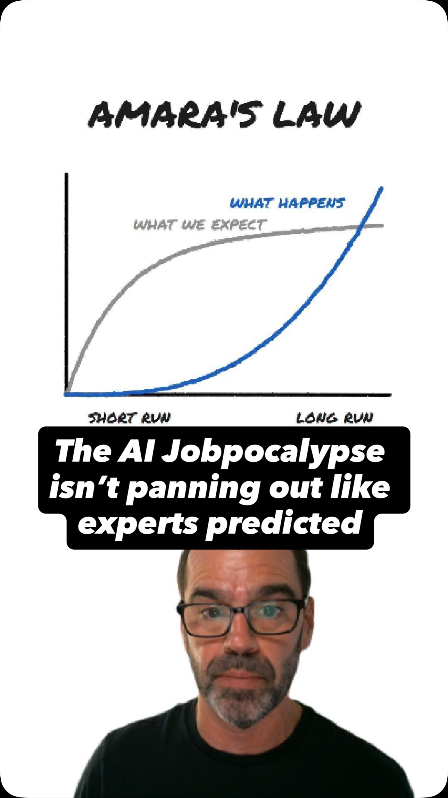
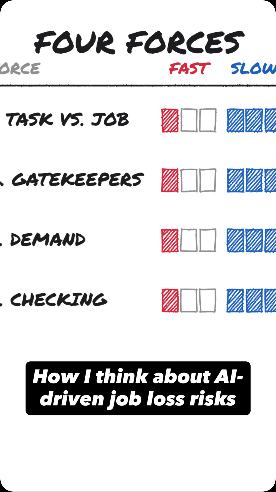
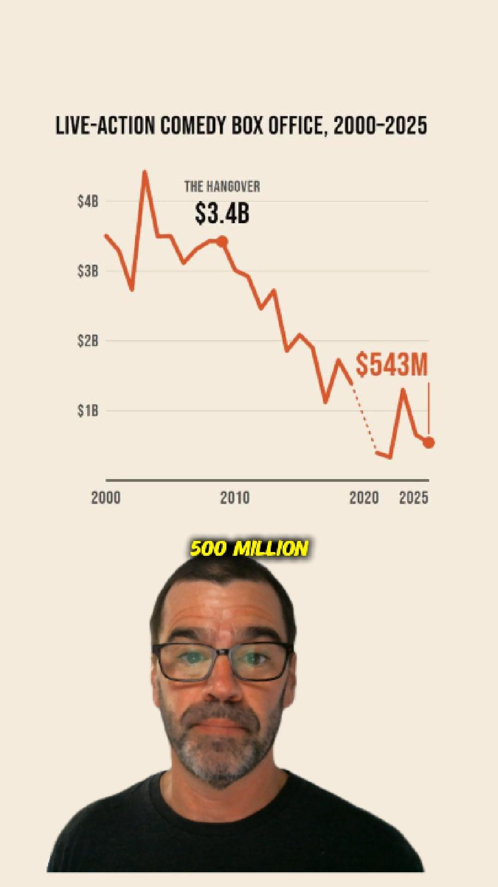

# David the Data Dude

The data, code and charts behind David the Data Dude's videos. Each project folder holds what the video didn't have time for: how the data was gathered, how it was analyzed, what went wrong along the way, and every chart, including the ones that didn't make the cut.

| Project | Question | Video |
|---|---|---|
| [`triple-d/`](triple-d/) | *Diners, Drive-Ins and Dives* has featured about 1,600 restaurants. How many are actually diners, drive-ins or dives? |  [Watch the Reel](https://www.instagram.com/reel/DeK1SQpS-qs/) |
| [`florida-alerts/`](florida-alerts/) | Florida's Silver Alerts put a missing senior's car on highway signs. Do they actually find the person? |  [Watch the Reel](https://www.instagram.com/reel/DePwOM8S0_S/) |
| [`ideabrowser/`](ideabrowser/) | A startup-idea newsletter emails one featured idea a day. What kind of businesses does it recommend, and how has that changed? |  [Watch the Reel](https://www.instagram.com/reel/DeSmb2hSPaw/) |
| [`radiology/`](radiology/) | In 2016, AI pioneer Geoffrey Hinton said to stop training radiologists. Ten years later, were they replaced? |  [Watch the Reel](https://www.instagram.com/reel/Decxhi7SGek/) |
| [`world-series/`](world-series/) | Every 2026 MLB player sorted onto a team by what kind of last name he has. Which kind of name fields the best team? |  [Watch the Reel](https://www.instagram.com/reel/DegxmR8Bf4h/) |
| [`four-forces/`](four-forces/) | A viewer said AI is "already displacing Jobs in millions." Across every U.S. occupation, how many jobs could AI plausibly be behind, and why do some fall fast while others grow? |  [Watch the Reel](https://www.instagram.com/reel/Dekc7YeyVgM/) |
| [`box-office/`](box-office/) | In 2023, *The Ringer* asked Hollywood to bring back the studio comedy. Three years later, are theatrical comedies showing signs of life? |  [Watch the Reel](https://www.instagram.com/reel/Deu4qZpyBvD/) |

Made by [Fractionalytics](https://github.com/Fractionalytics).

## License

Code, docs and charts are under the [MIT License](LICENSE). Data derived from Wikipedia (episode lists, seasons and air dates) remains under [CC BY-SA 4.0](https://creativecommons.org/licenses/by-sa/4.0/), as noted in each project. Figures and quoted text from government and nonprofit reports (FDLE, NCMEC/DOJ) belong to their publishers, as noted in each project. Ideabrowser's emails and ideas belong to Ideabrowser and aren't included; only our labels and counts are. Radiology's pay figures belong to Doximity and Medscape; its CMS, Census and FDA data are U.S. government works. World Series of Last Names' WAR figures come from Baseball-Reference (only the rostered players' are included), and its name meanings draw on Wiktionary and published surname dictionaries, whose text isn't included. Four Forces uses BLS data (U.S. government works) and the NY Fed's recent-graduate data, which belong to the Federal Reserve Bank of New York. Comedy Box Office's figures come from The Numbers, whose terms don't allow republishing their data, so that folder holds no data; the Reel's emoji are Twemoji (CC BY 4.0).
