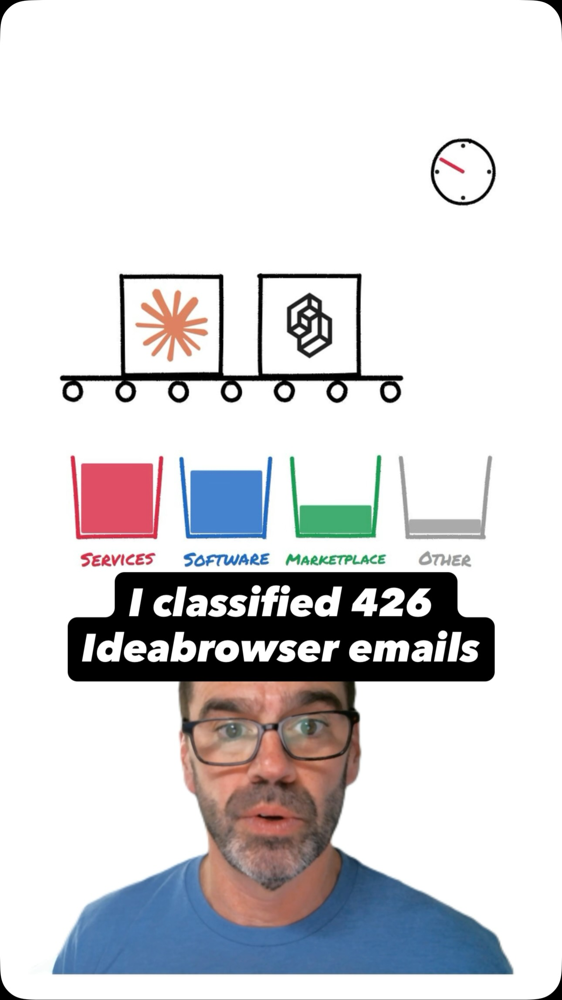
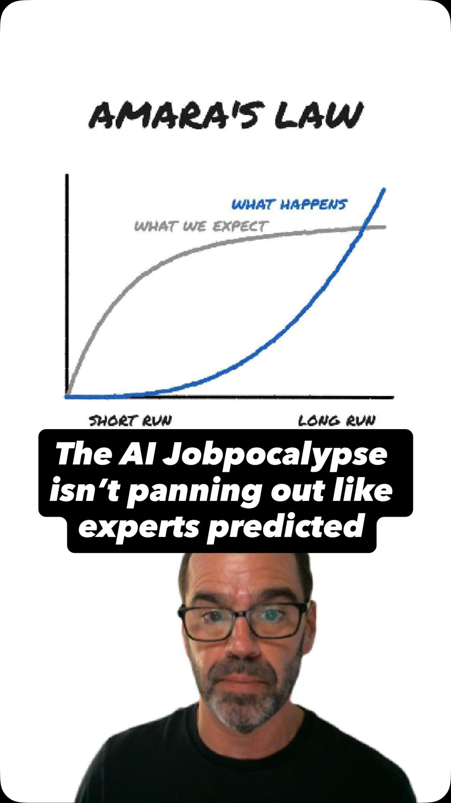
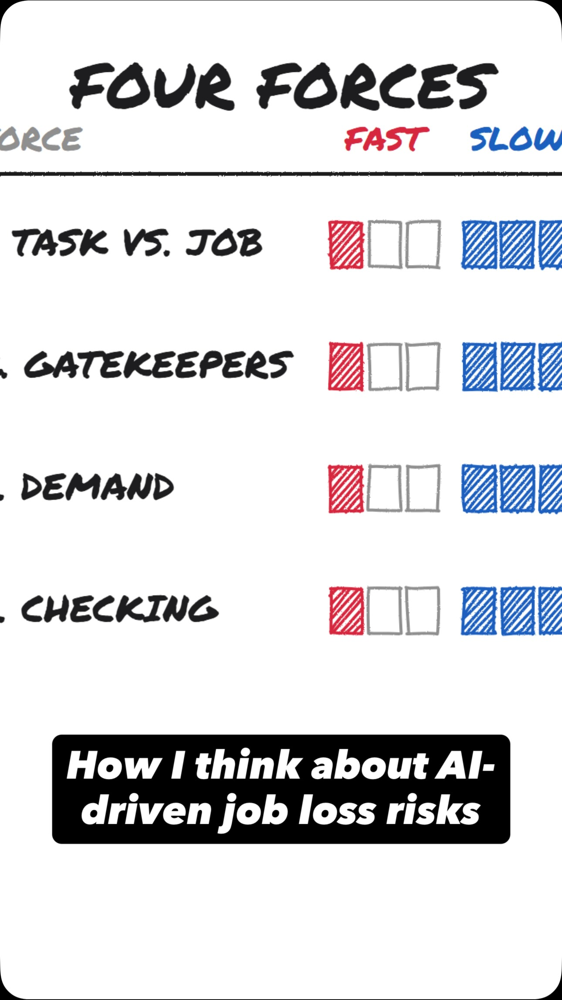
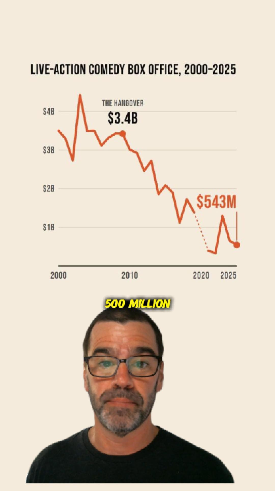
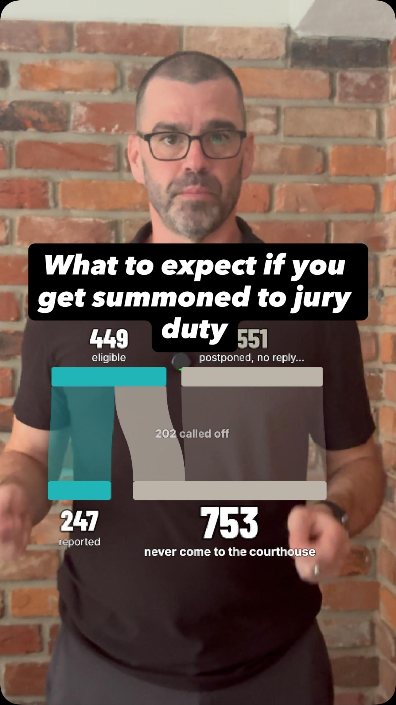
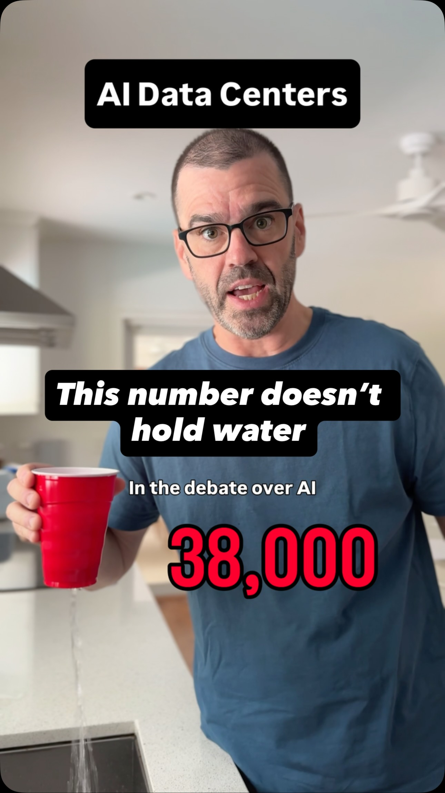
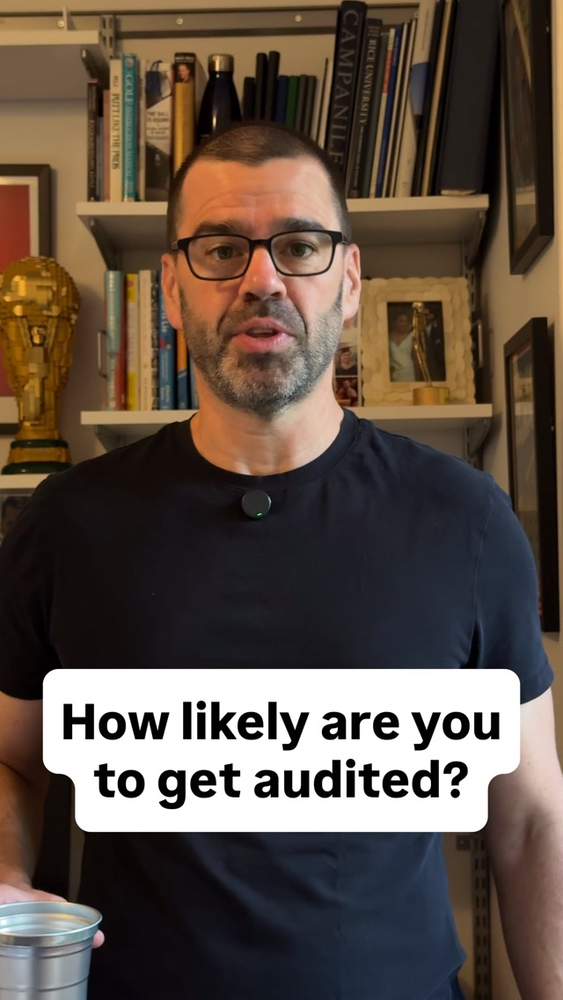
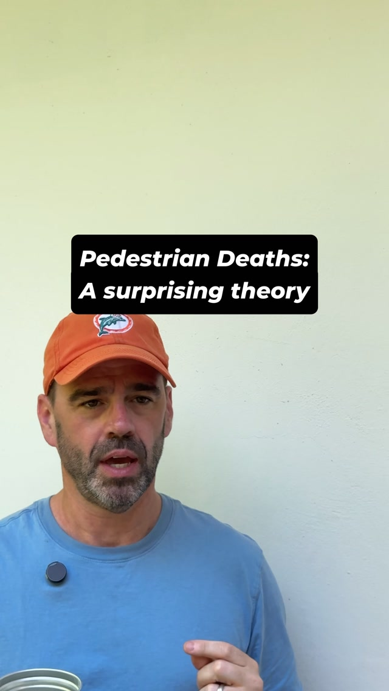
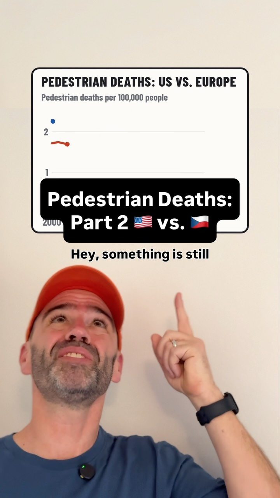
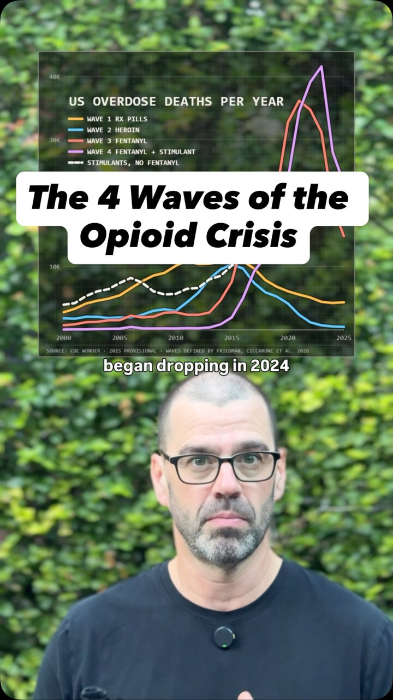

# David the Data Dude

The data, code and charts behind David the Data Dude's videos. Each project folder holds what the video didn't have time for: how the data was gathered, how it was analyzed, what went wrong along the way, and every chart, including the ones that didn't make the cut.

| Project | Question | Video |
|---|---|---|
| [`triple-d/`](triple-d/) | *Diners, Drive-Ins and Dives* has featured about 1,600 restaurants. How many are actually diners, drive-ins or dives? |  [Watch the Reel](https://www.instagram.com/reel/DeK1SQpS-qs/) |
| [`florida-alerts/`](florida-alerts/) | Florida's Silver Alerts put a missing senior's car on highway signs. Do they actually find the person? |  [Watch the Reel](https://www.instagram.com/reel/DePwOM8S0_S/) |
| [`ideabrowser/`](ideabrowser/) | A startup-idea newsletter emails one featured idea a day. What kind of businesses does it recommend, and how has that changed? |  [Watch the Reel](https://www.instagram.com/reel/DeSmb2hSPaw/) |
| [`radiology/`](radiology/) | In 2016, AI pioneer Geoffrey Hinton said to stop training radiologists. Ten years later, were they replaced? |  [Watch the Reel](https://www.instagram.com/reel/Decxhi7SGek/) |
| [`world-series/`](world-series/) | Every 2026 MLB player sorted onto a team by what kind of last name he has. Which kind of name fields the best team? |  [Watch the Reel](https://www.instagram.com/reel/DegxmR8Bf4h/) |
| [`four-forces/`](four-forces/) | A viewer said AI is "already displacing Jobs in millions." Across every U.S. occupation, how many jobs could AI plausibly be behind, and why do some fall fast while others grow? |  [Watch the Reel](https://www.instagram.com/reel/Dekc7YeyVgM/) |
| [`box-office/`](box-office/) | In 2023, *The Ringer* asked Hollywood to bring back the studio comedy. Three years later, are theatrical comedies showing signs of life? |  [Watch the Reel](https://www.instagram.com/reel/Deu4qZpyBvD/) |
| [`jury-duty/`](jury-duty/) | So you got summoned for jury duty. What are the odds you end up serving on a long trial? |  [Watch the Reel](https://www.instagram.com/reel/Dezay08yYg0/) |
| [`voting/`](voting/) | In the 2022 midterm, how many voters aged 65+ were there for every voter aged 18–24, and what happened when young people turned out in 2018? |  [Watch the Reel](https://www.instagram.com/reel/De1wb5Lygix/) |
| [`reformer-pilates/`](reformer-pilates/) | Twelve years and 780 reformer Pilates classes, from my own booking history. Laid out week by week, how often did the habit actually break? |  [Watch the Reel](https://www.instagram.com/reel/De9sA9KyFDP/) |
| [`altman-vs-almonds/`](altman-vs-almonds/) | Sam Altman says 38,000 ChatGPT queries use as much water as one California almond. Does the math hold up when both sides count the same water? |  [Watch the Reel](https://www.instagram.com/reel/DfIhVt9yflx/) |
| [`irs-audits/`](irs-audits/) | How likely are you to get audited? The IRS's own odds for every income band, and how many audits happen in person rather than by mail. |  [Watch the Reel](https://www.instagram.com/reel/DfShYlsyQYf/) |
| [`veterans/`](veterans/) | Half of veterans say they're uncomfortable hearing "thank you for your service," and half of civilians say they'd say it. Who are the 17.2 million living US veterans, and what did they give? |  [Watch the Reel](https://www.instagram.com/reel/DfVvhRsSXCE/) |
| [`pedestrians/`](pedestrians/) | Around 2009, US pedestrian deaths started rising while Europe's kept falling. Was it smartphones, SUVs, street design, or something else? Follow-up: Czechia has heavy meth users too, so why don't its pedestrians die like Americans? Follow-up 2: Americans and Europeans use stimulants at about the same rates, so why is the US drug death rate 13× Europe's? Follow-up 3: the four waves of the US opioid epidemic, from OxyContin to fentanyl, and why deaths fell after 2023. |  [Watch the Reel](https://www.instagram.com/reel/DfiKS-Gyysa/)  [Watch the follow-up](https://www.instagram.com/reel/Df2-Uumy7_n/)  [Watch follow-up 2](https://www.instagram.com/reel/Df5a2bHSDLG/)  [Watch follow-up 3](https://www.instagram.com/reel/DgBD8DnSr7N/) |
| [`thanksgiving-food-insecurity/`](thanksgiving-food-insecurity/) | The Thanksgiving dinner costs less than in 2022, and USDA stopped counting food insecurity after 2024. What do the numbers that are left say about people on the margins? | <!-- REEL LINK AND COVER: add after the Reel posts 2026-11-25 --><i>Posts Nov 25, 2026</i> |

Made by [Fractionalytics](https://github.com/Fractionalytics).

## License

Code, docs and charts are under the [MIT License](LICENSE). Data derived from Wikipedia (episode lists, seasons and air dates) remains under [CC BY-SA 4.0](https://creativecommons.org/licenses/by-sa/4.0/), as noted in each project. Figures and quoted text from government and nonprofit reports (FDLE, NCMEC/DOJ) belong to their publishers, as noted in each project. Ideabrowser's emails and ideas belong to Ideabrowser and aren't included; only our labels and counts are. Radiology's pay figures belong to Doximity and Medscape; its CMS, Census and FDA data are U.S. government works. World Series of Last Names' WAR figures come from Baseball-Reference (only the rostered players' are included), and its name meanings draw on Wiktionary and published surname dictionaries, whose text isn't included. Four Forces uses BLS data (U.S. government works) and the NY Fed's recent-graduate data, which belong to the Federal Reserve Bank of New York. Comedy Box Office's figures come from The Numbers, whose terms don't allow republishing their data, so that folder holds no data; the Reel's emoji are Twemoji (CC BY 4.0). Jury Duty's counts come from public court and agency reports (Wisconsin, Massachusetts, Oregon, Florida and others) and U.S. government data (U.S. Courts, the Federal Judicial Center, NCHS); those reports aren't republished, only our tables built from them. Voting's turnout-by-age figures come from the Census Bureau's Current Population Survey (U.S. government work); its national turnout figures come from the University of Florida Election Lab (Michael McDonald) under [CC BY 4.0](https://creativecommons.org/licenses/by/4.0/); and its age-of-Congress figures are built from the public-domain congress-legislators dataset. Altman vs. Almonds' almond water figures come from Fulton, Norton & Shilling (2019, CC BY-NC-ND), its power-plant water from EIA (U.S. government work) and Macknick et al. (2012), and its energy-per-reply estimates from EcoLogits (MPL-2.0); the paper itself isn't republished. IRS Audits' figures come from the IRS Data Book and the Census Bureau (U.S. government works) and Congressional Research Service reports; its pencil font, Caveat, is under the SIL Open Font License. Veterans' counts come from VA, the Census Bureau, BLS and DoD (U.S. government works); its survey results belong to Pew Research Center, USAA and YouGov and are quoted, not republished. Pedestrians' crash, census, CDC and BEA data are U.S. government works; its European figures come from Eurostat (reused with attribution) and its EU SUV shares from ICCT, which owns them; the New York Times, GHSA and cited papers are quoted, not republished; its follow-up's wastewater figures are summarized from EUDA with attribution, and its map uses public-domain Natural Earth outlines; its overdoses follow-up summarizes EUDA's European Drug Report with attribution, and its NSDUH figures are U.S. government works. Thanksgiving Food Insecurity's BLS, USDA, Census and CDC data are U.S. government works; AFBF's prices and the Feeding America, NEADA, NY Fed, LendingTree, NBC News and Purdue figures belong to their publishers and are quoted, not republished; its IBM Plex Mono fonts are under the SIL Open Font License.
