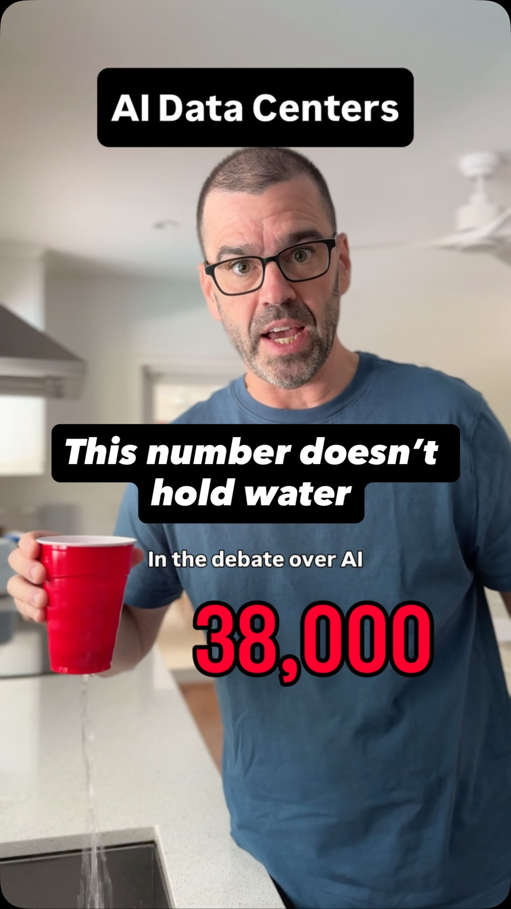

# Altman vs. Almonds: is one almond really worth 38,000 ChatGPT queries?

On the Sources Podcast (September 1, 2026), OpenAI CEO Sam Altman said that 38,000 ChatGPT queries use as much water as producing one California almond, and called it "total true water accounting." Does the math hold up?

This folder is the behind-the-scenes companion to David the Data Dude's [Instagram Reel](https://www.instagram.com/reel/DfIhVt9yflx/) on the question.

  
   
  <b>▶ <a href="https://www.instagram.com/reel/DfIhVt9yflx/">Watch the Reel on Instagram</a></b>

## The finding

**Altman's 38,000 reproduces exactly from two published numbers, but they don't count the same water.** An almond's full water footprint (12.29 L) divided by his 0.32 mL per query gives 38,190. Counting the same kinds of water on both sides, one change at a time (`data/ladder.csv`):

| Step | Water per almond | Water per query | Queries per almond |
|---|---|---|---|
| Altman's number: the almond's full footprint ÷ his per-query water | 12.29 L | 0.322 mL | **38,190** |
| Count only irrigation for the almond | 6.35 L | 0.322 mL | 19,729 |
| Add the research and training compute behind every answer | 6.35 L | 0.644 mL | 9,865 |
| Count power-plant water and data-center cooling | 6.35 L | 1.09 mL | **5,823** |

That's **about 6.6× fewer queries per almond** than he claimed.

These choices are conservative. They keep Altman's own 0.34 Wh per query (newer models with longer replies use several times more), leave out evaporation from hydropower reservoirs, and use OpenAI's 2025 R&D split rather than 2024's heavier one. Changing any of those pushes the gap past 10×. Other reasonable choices put it between about 5× and 7.5×:

| Judgment call | Queries per almond | Altman too high by |
|---|---|---|
| **Our choice** (above) | **5,823** | **6.6×** |
| 0.34 Wh doesn't already include data-center overhead (PUE) | 5,020 | 7.6× |
| Count only cooling water consumed, not withdrawn | ~6,400 | 5.9× |
| Texas grid instead of the US average | ~7,700 | 4.9× |
| A 300-token reply from a newer model (EcoLogits) | 3,536 | 10.7× |
| OpenAI's 2024 R&D split | 3,083 | 12.3× |
| Count hydro reservoir evaporation | 2,562 | 14.8× |

## Definitions

- **Water per almond** comes from Fulton, Norton & Shilling (2019), averaged over 2004–2015: 10,240 L per kg of kernels, at the paper's 1.2 g per kernel.
  - **Blue water** (5,290 L/kg, 6.35 L per almond): irrigation that's consumed.
  - **Green water** (570 L/kg): rain that falls on the orchard anyway.
  - **Grey water** (4,380 L/kg): a theoretical volume, the clean water it would take to dilute fertilizer runoff to the state nitrate standard. Nobody pumps it.
- **Water per query** = 0.34 Wh × (0.34 L/kWh cooling ÷ 1.16 PUE + 1.31 L/kWh at power plants) × 2 for R&D = 1.09 mL.
  - **0.34 Wh and 0.32 mL** are Altman's own figures, from one sentence of his June 2025 blog post. OpenAI publishes no methodology, water or energy data.
  - **Cooling** is Microsoft's published Americas FY25 rate: WUE 0.34 L/kWh (water withdrawn) and PUE 1.16. We assume the 0.34 Wh already includes data-center overhead, so the cooling rate is divided by PUE.
  - **Power-plant water** is the 2025 US generation mix (EIA) × the median water consumed per kWh by fuel (Macknick et al. 2012), hydro excluded.
  - **× 2 for R&D:** Epoch AI estimates OpenAI's 2025 compute was split roughly evenly between research and training and answering queries. This assumes water scales with compute spending.
- **"Altman too high by"** = 38,190 ÷ our queries per almond.

## What's here

| Folder | What |
|---|---|
| `data/` | `ladder.csv` (the steps above and the judgment calls), `scenarios.csv` (every almond basis × query-water basis), `like_for_like.csv` (six grid assumptions × four training allocations), `ecologits_energy.csv` (EcoLogits' energy and water per reply for six OpenAI models at 150–1,000 output tokens) |
| `scripts/` | `scenarios.py` writes the first three tables; every input is written out in the script with its source. `ecologits_energy.py` writes the fourth (`pip install ecologits==0.11.3`) |
| `docs/` | [Data challenges](docs/data-challenges.md): what went wrong along the way. [Sources](docs/sources.md): every number, where it came from and how it was checked |
| `video/` | The Remotion source for the Reel's animated cards |
| `stills/` | The final frame of each animated card, in the Reel's order |

## What nobody outside OpenAI can check

The 0.32 mL per query is one sentence in a blog post. OpenAI doesn't publish where it answers queries, its power mix, or how long an "average query" is. The grid is a range, not a measurement, and the training share comes from Epoch AI's estimates of leaked investor figures.

## Sources

- Altman: Sources Podcast with Alex Heath, [September 1, 2026](https://www.youtube.com/watch?v=VeizK1M7V7E&t=2052s) (around 34:16); ["The Gentle Singularity"](https://blog.samaltman.com/the-gentle-singularity), June 2025
- Fulton, J., Norton, M. & Shilling, F. (2019), "Water-indexed benefits and impacts of California almonds," *Ecological Indicators* 96, 711–717, [doi:10.1016/j.ecolind.2017.12.063](https://doi.org/10.1016/j.ecolind.2017.12.063). The study was funded by the Almond Board of California
- Microsoft, [datacenter efficiency](https://datacenters.microsoft.com/sustainability/efficiency/) (Americas FY25 WUE and PUE)
- U.S. Energy Information Administration, 2025 US generation mix; Macknick et al. (2012), *Environmental Research Letters* 7, 045802
- Epoch AI, [OpenAI compute spend](https://epoch.ai/data-insights/openai-compute-spend)
- EcoLogits v0.11.3: Rincé, S. & Banse, A. (2025), *Journal of Open Source Software* 10(111), 7471, [doi:10.21105/joss.07471](https://doi.org/10.21105/joss.07471)
- Li, Yang, Islam & Ren, ["Making AI Less 'Thirsty'"](https://arxiv.org/abs/2304.03271)
- PolitiFact, [September 4, 2026](https://www.politifact.com/factchecks/2026/sep/04/sam-altman/chatgpt-almonds-ai-california-water-useage/); CalMatters, [September 2026](https://calmatters.org/environment/2026/09/sam-altman-almonds-chatgpt-water/)

## License

Code, docs and charts are under the repo's [MIT License](../LICENSE). The almond water figures belong to Fulton et al. (CC BY-NC-ND); EIA data is a U.S. government work; Microsoft's and Epoch AI's figures belong to their publishers. EcoLogits is MPL-2.0.
