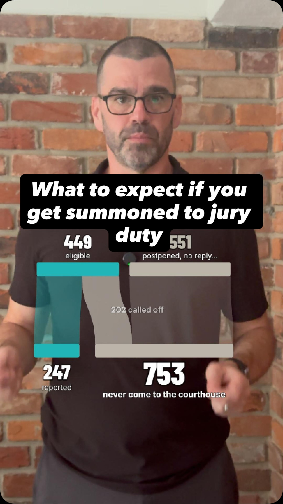

# Jury Duty: the odds of a long trial

So you got summoned for jury duty. What are the odds you end up serving on a long trial? This folder follows 1,000 people summoned to a state court, step by step, from the summons to the jury box to how many days they sit.

This folder is the behind-the-scenes companion to David the Data Dude's Instagram Reel.

  
   
  <b>▶ <a href="https://www.instagram.com/reel/Dezay08yYg0/">Watch the Reel on Instagram</a></b>

## The result

Per 1,000 people summoned to a state court:

| Step | Stay in | Drop out |
|---|---|---|
| Summoned | 1,000 | |
| Eligible and available | 449 | 551 postponed, didn't reply, were undeliverable, or were excused or disqualified |
| Reported to the courthouse | 247 | 202 called off before their date |
| Sent to a courtroom for jury selection | 155 | 92 sent home without reaching a courtroom |
| Sworn onto a jury | 48 | 107 not chosen |
| Days on trial (estimate) | 8 one day · 19 two days · 7 three days · **14 four or more days** | |

- **About 1 in 70** people summoned ends up on a trial of four or more days (14 per 1,000). That's an estimate; see "Days on trial" below.
- **753 of 1,000** never come to the courthouse (551 + 202).
- **48 of 1,000**, about 1 in 20, are sworn onto a jury. Of the 247 who show up, it's about 1 in 5.
- Most state trials run **2–3 days**. Trials lasting months, with the jury sequestered in a hotel (O.J. Simpson's jury was kept together for 265 days in 1995), are vanishingly rare.

## Where the funnel comes from

Every Wisconsin county files an annual "Basic Jury System Evaluation Report" (form CCAP-35) with the state court system. It counts each step: summonses, who's eligible, who reports, who's sent to jury selection, who's sworn, and trial days. Three counties post theirs publicly, and they're the only courts I found that publish the whole path:

| Per 1,000 summoned | Milwaukee 2024 | Racine 2015–2025 | Waukesha 2025 | **Used (median)** |
|---|---|---|---|---|
| Eligible and available | 364 | 612 | 449 | **449** |
| Reported to the courthouse | 128 | 247 | 252 | **247** |
| Sent to a courtroom | 98 | 155 | 225 | **155** |
| Sworn onto a jury | 48 | 44 | 93 | **48** |
| Trial days per trial | 1.7 | 2.4 | 2.0 | **2.0** |

Each step is the median of the three counties, so the funnel is a composite rather than one county's path. Racine's column pools 11 years.

## Definitions

- **Summoned:** summonses sent. Racine has used a two-step system since 2020: a questionnaire screens people first, and only those who qualify are summoned. That's why its "eligible" share runs high.
- **Eligible and available:** summonses minus those undeliverable, deceased, disqualified, excused, postponed, unanswered, or failing to appear (the form's "Total Eligible and Available").
- **Reported:** the form's "New/Reporting for Selection".
- **Called off:** eligible minus reported, which keeps the funnel adding up. It tracks the court's own "Cancelled / Called Off" count (median 221 per 1,000) but isn't identical, because people postponed from earlier terms also report. Racine's report gives the usual reasons: last-minute pleas and settlements, adjournments, and defendants who don't appear.
- **Sent to a courtroom:** reported minus the form's "Not Used". The form's "Sent to Voir Dire" counts seats, and one juror can sit in more than one jury selection, so it can't be used to count people.
- **Sworn:** the form's "Sworn Jurors".

## Days on trial

No state publishes trial-by-trial lengths, so the split of the 48 sworn jurors is an estimate. It comes from Massachusetts, which uses "one day or one trial", so nearly everyone who serves past day one is on a trial:

- In fiscal 2015, Massachusetts counted days served by all 206,909 jurors who served: 88.8% one day, 5.3% two, 1.9% three, 4.0% four or more.
- In 2025, sworn jurors were 13.5% of those who appeared (24,510 of 181,383).
- Treating everyone who served more than a day as sworn, the sworn split is about 17% one day, 39% two, 14% three and 30% four or more. Applied to 48, that's 8, 19, 7 and 14.

Check: Massachusetts' own fiscal 2015 count of everyone summoned who served four or more days is 8,296 of 656,712, or 1.3%. That matches the 1.4% (14 per 1,000) here.

Trial length varies by place and case: 1.7–2.4 days per trial in the Wisconsin counties, 2.5 in Lake County, Illinois, and 4.2 in Jackson County, Missouri. Civil trials run longer than criminal ones, and felonies longer than misdemeanors (Waukesha 2025: civil 2.8 days, felony 2.3, misdemeanor 1.1).

## Cross-checks

From summons to sworn jury, Wisconsin lines up with the other places that publish part of the funnel:

| Source | What it shows |
|---|---|
| Minnesota, statewide 2024 | 11,179 of 217,476 summoned (5.1%) served on a trial jury |
| Oregon, all 36 counties 2025 | 829,744 summoned; 105,274 reported (12.7%); 1.68 days served per juror |
| Florida, all 67 counties 2024 | Summoning yield (people available per summons) by county, median 38% |
| Massachusetts, fiscal 2012–2015 | 31–33% of summonses led to service; 10.7–11.3% of those who served sat more than one day |
| Pennsylvania, statewide 2015 | 1,238,807 summoned; 237,749 asked to report (19%) |
| New Mexico, statewide 2025 | About 45,000 reported; about 8,200 seated on a trial or grand jury |
| Jackson County, MO, 2025 | 73 jury trials, 310 trial days |
| U.S. district courts, FY2025 | 146,290 jurors present for selection; 21.6% selected; about 4.6 trial days per jury |

**State vs. federal.** State courts handle about 98% of jurors: about 146,000 people report for federal jury selection a year, against roughly 8–11 million for state courts (National Center for State Courts estimates). Federal trials run longer. In federal civil jury trials ending in fiscal 2019–2025 (6,692 trials with dates, Federal Judicial Center data), the median was 4 weekdays, and 96% lasted more than one day.

## Inspiration

John Johnson's Sankey diagram of Milwaukee County's 2024 jury summonses on the [Marquette University Law School Faculty Blog](https://law.marquette.edu/facultyblog/2025/12/the-odds-of-jury-duty/) ("The Odds of Jury Duty", December 17, 2025). This project adds more counties, the cross-checks and the days on trial.

## Files

- `data/`: the Racine reports' counts (2015–2025), the Wisconsin spine, every source's stage rates, the Oregon and Florida county tables (with rural/urban codes), Massachusetts' fiscal 2012–2015 counts, and the federal civil trial-length distribution.
- `scripts/`: how each table was built. The scripts read the original reports, which aren't republished here (see Sources); `requirements.txt` lists the Python packages.
- `docs/data-challenges.md`: everything that went sideways, from forms that count seats instead of people to a codebook that called live fields dead.
- `video/`: the Remotion source for the Reel's animated Sankey. `videos/` has the rendered animation, without David.

## Sources

- **Wisconsin county jury reports (CCAP-35):** [Racine County](https://www.racinecounty.gov/departments/clerk-of-circuit-court/info-resources/court-information), 2015–2025; [Waukesha County 2025 Annual Jury Program Report](https://www.waukeshacounty.gov/media/rwepff4t/2025-annual-jury-program-report-revised-05062026.pdf); Milwaukee County 2024 (as published with the Marquette blog post above).
- **Massachusetts Office of Jury Commissioner:** annual reports, fiscal 2012–2015, and [juror demographic reports](https://www.mass.gov/lists/juror-demographics-quarterly-and-annual), 2025.
- **Oregon Judicial Department:** "Jury Data Overview: Oregon Circuit Courts", April 2026.
- **Florida Office of the State Courts Administrator:** Jury Management Indices Report, quarter ending December 31, 2024.
- **Jackson County, Missouri (16th Circuit):** [Jury Supervisor's Annual Report](https://www.16thcircuit.org/statistical-information), 2025.
- **Minnesota House Research:** "State Jury Service", November 2025.
- **New Mexico Administrative Office of the Courts:** Juror Appreciation Week release, March 23, 2026.
- **Pennsylvania Administrative Office of Pennsylvania Courts:** [InfoShare release](https://www.pacourts.us/news-and-statistics/news/news-detail/924/selecting-jurors-in-a-pennsylvania-trial), December 1, 2016.
- **U.S. Courts:** [Judicial Business tables](https://www.uscourts.gov/statistics-reports/analysis-reports/judicial-business-united-states-courts) J-2, J-10, T-1 and T-2, fiscal 2023 and 2025.
- **Federal Judicial Center:** [Integrated Database](https://www.fjc.gov/research/idb), civil cases.
- **NCHS:** 2023 Urban–Rural Classification Scheme for Counties.

## License

MIT, like the rest of this repo. The underlying reports are public records from the courts and agencies above and aren't republished here; the scripts read them from their sources.
