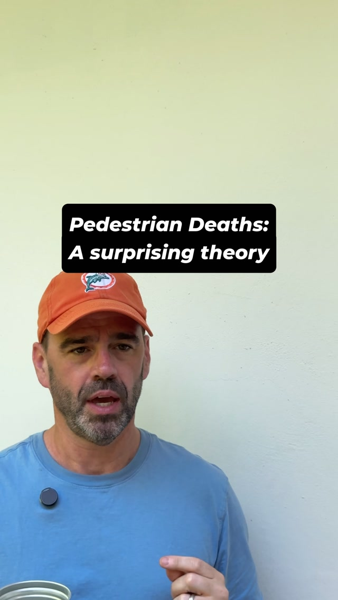
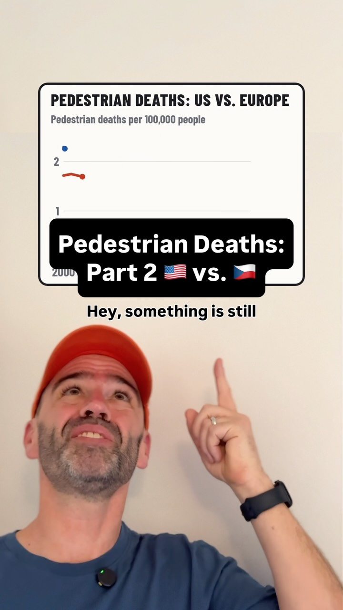

# Pedestrians: why did US pedestrian deaths rise while Europe's fell?

Around 2009, US pedestrian deaths started rising while Europe's kept falling. This folder tests the usual explanations (smartphones, SUVs, street design) and the one that held up best: methamphetamine.

This folder is the behind-the-scenes companion to David the Data Dude's Instagram Reel.

  
   
  <b>▶ <a href="https://www.instagram.com/reel/DfiKS-Gyysa/">Watch the Reel on Instagram</a></b>

## The result

**US vs. Europe** (pedestrian deaths per 100,000 people)

| | 2000 | 2009 | 2024 |
|---|---|---|---|
| US | 1.72 | 1.37 | 2.16 |
| Europe (18 EU members) | 2.29 | 1.40 | 0.75 |

In 2009 the two were about even. By 2024 the US rate was 2.9 times Europe's.

**Where the US rise happened** (share of the increase from 4,109 deaths in 2009 to 7,593 in 2022)

| | Share of the increase |
|---|---|
| Urban or suburban | 99% (rural deaths: 1,146 in both years) |
| After dark (6pm–6am) | 84% |
| Mid-block, not at an intersection | 84% |
| On arterial roads | 71% |
| Adults 25–64 | 75% |
| Men | 72% |
| South and West (62% of the population) | 84% |

The pedestrian death rate rose 83% in the poorest fifth of neighborhoods and 50% in the richest fifth (2009–11 to 2020–22).

**The usual suspects**
- **Smartphones and SUVs:** Europe got both. SUVs went from 7% of new EU cars in 2009 to 49% in 2024, and Europe's pedestrian deaths kept falling.
- **Taller hoods:** about 10% of the US rise, per the New York Times' own model (Keller, June 21, 2026).
- **Vision Zero:** of 18 US cities that pledged early (2012–2016), only New York had a statistically significant drop in pedestrian deaths (Ferenchak, 2023).

**Methamphetamine**
- Among pedestrians killed and tested for drugs, the share positive for a stimulant held at 9–11% from 2007 to 2014, then rose to 31% by 2024. In the four states that tested at least 70% of pedestrians killed every year (Maryland, New Jersey, Washington, West Virginia), it rose from about 8% to about 21%, so the rise isn't a change in who gets tested.
- States with bigger rises in meth overdose deaths had bigger rises in pedestrian deaths (2009–11 to 2020–22): r = 0.35 across 38 states, 0.65 without West Virginia. The Reel's scatterplot leaves West Virginia out; both checks were set in advance.
- When meth overdose deaths fell (35,982 in 2023 → 26,260 in 2025, CDC provisional), pedestrian deaths fell too, but so did other road deaths.
- A positive test shows a drug was present, not that the person was impaired. On the Bradford Hill criteria, the evidence meets temporality, biological gradient, plausibility and consistency, half-meets experiment, and doesn't show strength, specificity, coherence or analogy. That builds a case, not proof.

## Follow-up: Europe has drugs too (US vs. Czechia)

  
   
  <b>▶ <a href="https://www.instagram.com/reel/Df2-Uumy7_n/">Watch the follow-up Reel on Instagram</a></b>

If Europeans take stimulants too, why don't their pedestrians die the way Americans do? The follow-up compares the US with Czechia, Europe's meth country.

**Why Czechia:** meth is rare in most of Europe. In EUDA's 2025 wastewater survey of 121 European cities, the median Czech city had about 464 mg of meth per 1,000 people a day, against about 7 for the rest. Czechia is also the only European country with published drug-by-drug test results for pedestrians killed: two studies of its forensic autopsy register, covering 2003–05 and 2016–21. France reports only "any illegal drug" for pedestrians; Germany, the UK and most others report drugs for drivers only; Slovakia publishes nothing; Spain's pedestrians test positive for cocaine, not meth.

**US as a multiple of Czechia, per person**

| | US ÷ Czechia | Numbers |
|---|---|---|
| Stimulant-positive dead pedestrians, 2016–21 | **13×** | 2.67 vs. 0.20 per million a year (tested and positive) |
| Heavy meth users, 2016 | **3.3×** (range 1.3–5.5×) | 3.2M ÷ 323M vs. 31,600 ÷ 10.55M |
| Risk per heavy user (13 ÷ 3.3) | **about 4×** (range 2.4–9.8×) | inferred, not measured |

**Czechia got safer.** Among tested pedestrians killed with no stimulants found, Czechia's rate fell 46% (9.7 → 5.3 per million a year, 2003–05 to 2016–21) while the US rate rose 33% (6.8 → 9.0). For all pedestrian deaths, Czechia went from 1.7× the US rate (28.4 vs. 16.3 per million) to about half of it (11.2 vs. 19.7).

**Why the US rise started.** Matthew Brumbelow, a researcher at the Insurance Institute for Highway Safety, checked about 20 factors in his own analysis ([report](https://www.researchgate.net/publication/408773617_Pedestrian_impairment)). Almost none shifted around 2010; the two that did were night crashes on urban arterials and pedestrians' drug tests. US overdose deaths involving meth and no opioids rose about 10× from 2009 to 2024 (0.3 to 3.3 per 100,000).

**Working in tandem (states, 2018–24, pre-registered test P25).** Meth-positive pedestrian deaths per million a year, 49 states split at the median on each measure:

| | Less meth | More meth |
|---|---|---|
| **Deadlier roads** | 3.3 (10 states) | **7.8** (14 states) |
| **Safer roads** | 0.8 (15 states) | 3.7 (10 states) |

The pattern holds counting tested positives only, and with meth overdoses that involved no fentanyl. It doesn't hold if road danger is measured by vehicle-occupant deaths instead of pedestrian deaths, and it's a pattern across states, not proof of cause.

**Other factors:** taller vehicles explain about 10% of the US rise (New York Times model). Getting hit became deadlier around 2020–21 (share of pedestrians hit who died: about 7.6% in 2016–18, about 11% in 2020–21).

## Definitions

- **Pedestrian death:** NHTSA FARS person type 5 (pedestrian), injury severity 4 (fatal). For the US vs. Europe comparison, people on personal conveyances (skateboards, scooters and similar) are added, to match how Europe counts pedestrians.
- **Europe:** the 18 EU members that reported pedestrian deaths to Eurostat every year from 2000 to 2024, so every year compares the same countries.
- **Stimulant-positive:** at least one drug result of methamphetamine, amphetamine or cocaine among pedestrians killed with a valid drug test. FARS changed its drug codes in 2022; the named drugs were matched across both schemes.
- **Meth overdose deaths:** death certificates listing psychostimulants with abuse potential (ICD-10 T43.6), mostly methamphetamine.
- **Neighborhood poverty:** 2010 census tracts, ranked by share of residents below the poverty line (ACS 2008–12), in fifths of the population; crashes are placed in tracts by their coordinates.
- **Czech stimulant-positive (follow-up):** meth or ecstasy in blood (2003–05, Mravčík et al.); meth or cocaine metabolite in blood (2016–21, Másilková & Vorel). Czechia counts blood results only and deaths within 24 hours of the crash.
- **Per-million rates by test result (follow-up):** "tested and positive" counts only pedestrians with a positive result. The "no stimulants found" and all-pedestrian rates assume untested pedestrians look like tested ones.
- **Heavy meth users (follow-up):** US = RAND's chronic users, 4 or more days a month (RR-3140, best estimate, 2016); Czechia = high-risk meth users (National Monitoring Centre, table 3-7, 2016). Definitions differ.
- **Meth-only overdose deaths (follow-up):** overdose deaths (underlying cause X40–X44, X60–X64, X85, Y10–Y14) listing T43.6 and none of T40.0–T40.4 or T40.6, per 100,000 people.
- **State groups (follow-up):** meth = meth (T43.6) overdose deaths per 100,000, 2018–24; roads = estimated pedestrians killed with no stimulants found per million a year (FARS). Each split at the median state. Vermont and Wyoming are left out (fewer than 30 tested pedestrians).
- **Pre-registered tests:** each test's prediction and pass/fail rule was written down and committed before it was run (`docs/hypothesis-test.md`), and every result is reported against its rule, passes and failures alike.

## Files

- `data/`: the final datasets behind every number and chart in the first Reel. `data/follow-up/`: the same for the follow-up (US vs. Czechia buckets, the state test, meth-only overdoses, and `reel3_numbers.json` with every on-screen number).
- `scripts/`: the scripts behind the Reels' numbers (exploratory and research scripts aren't included, so some scripts named in `docs/` aren't here). `fetch_fars.py`, `fetch_eurostat.py` and `fetch_fred.py` download the public source files, which aren't republished here. CDC WONDER and HUD files were downloaded by hand from their sites; `requirements.txt` lists the Python packages.
- `docs/hypothesis-test.md`: every pre-registered test, its rule and its result.
- `docs/bradford-hill.md`: how the evidence scores on each of Hill's nine viewpoints, and why.
- `docs/data-challenges.md`: what went sideways, from drug codes that changed four years after a file "overhaul" to two official numbers for the same country's deaths.
- `video/`: the Remotion source for the Reels' animated charts (`src/` for the first, `src/reel3/` for the follow-up). It imports layout and fonts from a shared kit that isn't published here.

## Sources

- NHTSA, [Fatality Analysis Reporting System (FARS)](https://www.nhtsa.gov/research-data/fatality-analysis-reporting-system-fars), 2000–2024; [Early Estimate of Motor Vehicle Traffic Fatalities in 2025](https://crashstats.nhtsa.dot.gov/Api/Public/ViewPublication/813800) (DOT HS 813 800).
- Eurostat, road fatalities by category of person (`tran_sf_roadus`).
- ICCT, European Vehicle Market Statistics Pocketbook 2025/26 (EU SUV share); BEA via FRED (US light-truck share).
- CDC WONDER, Multiple Cause of Death (T43.6, age-adjusted, by state); CDC/NCHS Provisional Drug Overdose Death Counts (data.cdc.gov `xkb8-kh2a`).
- Census Bureau, American Community Survey 2008–12 and TIGER/Line 2010 tracts.
- GHSA, Pedestrian Traffic Fatalities by State: 2025 Data (projection).
- Keller, M. H., "The Deadly Rise of Giant Trucks and S.U.V.s," *The New York Times*, June 21, 2026.
- Ferenchak, N. (2023), "U.S. Vision Zero Cities: modal fatality trends and strategy effectiveness," *Transportation Letters* 15(8), 957–968.
- Brumbelow, M. (2026), "Pedestrian fatalities and methamphetamine impairment," independent analysis, not peer reviewed ([ResearchGate](https://www.researchgate.net/publication/408773617_Pedestrian_impairment)).
- Mravčík, V., Vorel, F. & Zábranský, T. (2007), *Central European Journal of Public Health* 15(4), 158–162; Másilková, M. & Vorel, F. (2023), *Soudní lékařství* 68(2), 19–23.
- RAND, *What America's Users Spend on Illegal Drugs, 2006–2016* (RR-3140); Czech National Monitoring Centre for Drugs and Addiction, *Report on Illicit Drugs in the Czech Republic 2023*.
- EUDA, *Wastewater analysis and drugs: a European multi-city study* (2025 campaign).
- CDC WONDER, Multiple Cause of Death (meth overdoses with and without opioids, 2009–2024; by state, 2018–2024); NHTSA CRSS/GES (pedestrians injured).
- Tyndall, J. (2021), "Pedestrian deaths and large vehicles," *Economics of Transportation* 26, 100219.
- Natural Earth, 1:50m countries (public domain), for the map.
- Hill, A. B. (1965), "The Environment and Disease: Association or Causation?" *Proceedings of the Royal Society of Medicine* 58(5), 295–300.

Made by [Fractionalytics](https://github.com/Fractionalytics).

## License

Code, docs and charts are under the repo's [MIT License](../LICENSE). FARS, Census, CDC and BEA data are U.S. government works. Eurostat data is reused under Eurostat's reuse policy, with attribution. EU SUV shares are read from ICCT's pocketbook and belong to ICCT. The New York Times, GHSA and the cited papers (including Brumbelow's report and the Czech studies) are quoted and cited, not republished. EUDA's wastewater figures are summarized with attribution; its city table isn't republished. Natural Earth is public domain.
