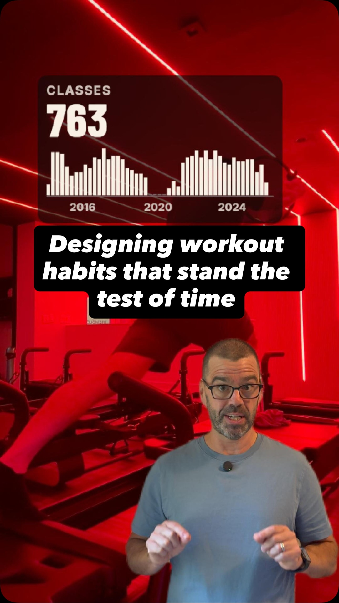

# Reformer Pilates: 780 classes, twelve years

I booked my first reformer Pilates class on 4 December 2014 and I have been going ever since. This folder holds the numbers behind the Reel: every class I attended, when I booked it, and what the record looks like when you lay all 621 weeks out side by side.

This folder is the behind-the-scenes companion to David the Data Dude's Instagram Reel.

<p align="center">
  <a href="https://www.instagram.com/reel/De9sA9KyFDP/"></a>
  <br>
  <b>▶ <a href="https://www.instagram.com/reel/De9sA9KyFDP/">Watch the Reel on Instagram</a></b>
</p>

## The result

**780 classes between 4 December 2014 and 22 October 2026.** The number in the Reel that surprised me is the one about weeks, not classes:

| | |
|---|---|
| Calendar weeks counted | **517** |
| Weeks with no class | **29** |
| Times two missed weeks ran back to back | **once** |

Not counting 2020 and 2021 — see **What "517 weeks" means** below.

## What the words in the Reel mean

The Reel leans on three definitions. All of them are arbitrary choices I made, so here they are exactly.

**A "class"** is an attended reservation: a row in my Tremble history with status `check in`. Cancellations are in the data (`status` and `cancel_date`) but do not count as classes. Three classes after the 9 October export date — 11 October, 15 October and 22 October 2026 — were still `pending` in the file; I confirmed I attended all three, so they count. That is what makes the total 780 rather than 777.

**A "week"** is a Monday-to-Sunday calendar week. A week counts as attended if I took **any** class in it, whether one or four. The grid in the Reel has one square per week from the week of my first class to the week of my last: **621 weeks**.

**"517 weeks"** excludes every week of 2020 and 2021. I stopped going when the studio closed and did not go back properly for 457 days, and through 2021 I kept away during the variant waves — a personal policy, not a public-health instruction. Those are 104 weeks, so 621 − 104 = 517. Counting those years would make "missed two weeks in a row" three times rather than once: the 64-week shutdown, twelve weeks in autumn 2021 and three in December 2021. The one that falls outside them is a two-week gap starting 9 September 2024.

**"213 Sunday mornings with Szabi"** means classes that were all four of: taught by that instructor, on a Sunday, starting at 8:30, in the twelve-year record. Each condition cuts the count — 237 classes with him in total, 229 of those on Sundays, 213 of those at 8:30, and **145** of those also on machine 3.

**"30 days ahead"** is Tremble's booking window. The longest lead time anywhere in my history is 30.0 days and nothing exceeds 31, which is how I know where the wall is.

## What is here

| Path | What |
|---|---|
| `data/tremble_attendance.csv` | All 957 reservations, 780 of them attended. De-identified: see below |
| `charts/week_grid.png` | The 621-week grid, with the COVID block and the one double-missed week marked |
| `charts/sundays_by_quarter.png` | Sunday classes per quarter |
| `charts/weekends_by_quarter.png` | Weekend against weekday, by quarter |
| `charts/time_of_day.png` | What time of day I go, and how that moved |
| `scripts/` | The analysis that produced the numbers above |
| `docs/data-challenges.md` | What went wrong in the data, with the numbers |

### About the data file

Nine columns: `start_datetime`, `status`, `attended`, `created_at`, `cancel_date`, `class_type`, `spot`, `location`, `instructor`.

Two things to know before you compute anything from it:

- **`created_at` reads `2020-07-07` for every class before March 2020.** That is the day my old history was migrated into the studio's current booking system, not a real booking date. Any "how far ahead did he book" figure has to start from mid-2021, which is what the analysis here does.
- **`instructor` holds first names only.** Seven first names belong to two different people in my history, so those pairs are merged in this file — most consequentially one first name covering 39 classes with one instructor and 31 with another. Instructors' full names and every identifier are deliberately absent.

### What is deliberately not here

- **Apple Health.** I wore an Apple Watch for the later years of this, so heart rate and workout durations exist for some of these classes. None of it is published, no count derived from it is published, and no figure in the Reel depends on it. (The Reel calls the class 50 minutes; that is simply how long it is scheduled for.)
- **The Reel itself**, which is over GitHub's file size limit. Watch it on Instagram.
- **The animation source.** The charts in the Reel are Remotion compositions laid over my own footage of a class; the footage is not mine to publish, and the compositions are not much use without it.

## Running it

```bash
pip install -r scripts/requirements.txt
python scripts/build_public_data.py   # rebuilds the published CSV from the raw export
python scripts/missed_weeks.py        # the 517 / 29 / once figures
python scripts/book_ahead.py          # how far ahead I book, by year and half-year
```

The scripts expect the raw Tremble export and the intermediate files that live in the private workspace, so they are here as the method rather than as something that runs end to end from this folder alone. `build_public_data.py` is the exception worth reading: it is exactly how the file in `data/` was cut, including the assertion that no name or identifier survived it.

## Framework

The Reel is built on James Clear's *Atomic Habits* (2018): the four-stage habit loop — cue, craving, response, reward — and the "never miss twice" rule are his.

One credit worth getting right: **"habit loop" is Charles Duhigg's term**, from *The Power of Habit* (2012). Clear credits Duhigg for it on the same page his stage definitions come from, and extended the loop from Duhigg's three stages to four by adding craving.

## License

Code, docs and charts here are under the repository's [MIT License](../LICENSE). The attendance data is my own record of my own classes.
